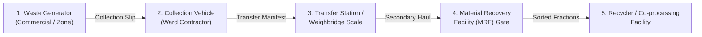

# 02 — Problem and User Context

## 1. The Municipal Waste Custody Lifecycle

In urban municipal solid waste (MSW) operations, managing recyclables, wet waste, and dry fractions involves handovers across physical and organizational boundaries. Each transition represents a critical point where mass, composition, or custody tracking can degrade.

### Typical Custody Stages
1. **Generator / Ward Collection:** Municipal or private contracted crews collect segregated or mixed waste from commercial wards, residential bulk generators, or community bins. A primary collection slip records estimated weight or bin volume.
2. **First Transit (Ward to Transfer Station):** Primary tipper vehicles transport loads to intermediate transfer stations or decentralized sorting hubs.
3. **Transfer Station / Gross Weighment:** The transport vehicle crosses an automated or manual weighbridge. Gross weight and tare weight (empty vehicle) are measured to compute net payload.
4. **MRF Inbound Reception:** The consignment arrives at the Material Recovery Facility. A receiving clerk inspects the manifest, verifies the vehicle ID, and registers the inbound batch into MRF inventory.
5. **Secondary Sorting & Outbound Recovery:** Waste is separated into categories (PET, HDPE, Cardboard, Refuse-Derived Fuel (RDF), Organic Compost). Sorted bales or fractions are dispatched to specialized end processors with outbound weighments.

---

## 2. Key User Personas

| Persona | Primary Goal | Current Pain Point | How ChakraSaakshya Helps |
| :--- | :--- | :--- | :--- |
| **Municipal Compliance Supervisor** *(e.g., Ward Officer / Municipal Auditor)* | Ensure contracted waste operators fulfill concessionaire tonnage agreements and prevent diversion of waste to illegal dumps. | Sifting through thousands of paper weighment slips and disconnected Excel logs weeks after incidents occur. | Instantly receives flagged custody breaks, visualized graph paths, and contractor-level risk correlations. |
| **MRF Operations Auditor** *(e.g., Facility Quality Lead)* | Reconcile material balance between inbound gate manifests and outbound sorted recovery bales to detect sorting leakages. | Inability to track batch splits and merges across secondary hauls; unable to verify if upstream trucks delivered full claimed payloads. | Audits split-batch lineages and identifies exact handover points where weight mismatches originated. |
| **Contractor Fleet Manager** *(e.g., Logistics Vendor Lead)* | Maintain operational compliance, resolve erroneous discrepancy flags, and audit driver/vehicle performance. | False accusations of diversion caused by uncalibrated municipal scales or weather-induced moisture loss. | Transparently inspects evidence logs, timestamps, and scale calibration records, enabling documented review comments. |

---

## 3. Real-World Discrepancy Scenarios (Fictional Examples)

To design effective investigation rules, ChakraSaakshya focuses on four common operational breakdown modes:

### Scenario A: Unexplained Weight Variance (The Shrinking Load)
- **Fictional Context:** Collection Vehicle `V-401` records a net pickup of **1,200 kg** of mixed dry waste from Zone North at 08:30.
- **MRF Weighment:** When the vehicle arrives at Central MRF at 11:15, the gate scale records net weight as **850 kg** (a 350 kg / 29.1% deficit).
- **Investigation Need:** The system must verify whether a secondary transfer occurred, whether gross-tare calculations were reversed, or whether an unexplained loss must be flagged for driver interview.

### Scenario B: Missing Handover Receipt (The Phantom Manifest)
- **Fictional Context:** Ward manifest shows Load `L-882` dispatched on Vehicle `V-109` to Eastern Processing Hub.
- **MRF Inbound:** No inbound gate record, tare measurement, or receiving acknowledgement exists at Eastern Processing Hub for `L-882`.
- **Investigation Need:** Identify the last validated custody node and alert the compliance officer that the load disappeared between departure and MRF entry.

### Scenario C: Category Contradiction (Grade Substitution)
- **Fictional Context:** Handover 1 classifies Load `L-304` as "High-Grade Sorted Rigid Plastics (HDPE)" valued at premium processing subsidies.
- **MRF Inbound Handover 2:** Inbound quality check registers the batch as "Mixed Low-Grade Contaminated Film Plastic."
- **Investigation Need:** Flag the category mutation across handovers so auditors can determine if improper material was accepted or mislabelled during transit.

### Scenario D: Evidence Duplication (Recycled Scale Tickets)
- **Fictional Context:** Contractor submits weighbridge ticket PDF #W-9092 for Load `L-512` at 09:00, and later attaches the identical digital scan (identical cryptographic hash) for Load `L-530` at 14:00 on a different route.
- **Investigation Need:** Detect identical evidence node hashes attached to disjoint handover nodes, preventing double-billing for single transport runs.

---

## 4. Privacy & Ethical Safeguards

1. **No Personal Identifiable Information (PII):** Human actors (drivers, weighbridge clerks) are represented in the graph using pseudonymous identifiers (e.g., `ACTOR-DRV-104`, `ACTOR-CLK-089`) rather than national IDs, phone numbers, or residential addresses.
2. **Vehicle Pseudonyms:** Vehicles use fleet code abstractions (e.g., `VEH-TRK-77`) rather than live government registration plates where prohibited by data guidelines.
3. **Objective Tone:** The system frames all alerts as discrepancies, never attributing intentionality or criminal malice.
