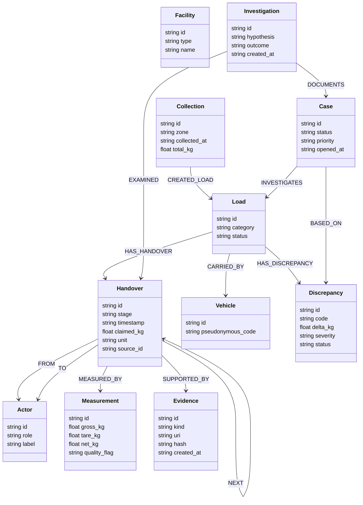
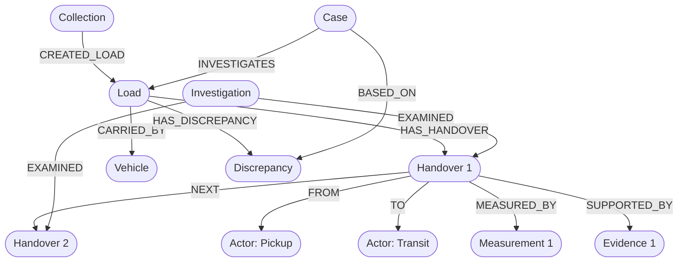

# 03 — Conceptual Graph Schema

> **Notice:** This document defines the conceptual property graph model for ChakraSaakshya. It serves as an architectural blueprint for development during the hackathon. It does not contain executable database commands or running DDL scripts.

---

## 1. Schema Overview

The custody chain is modeled as a directed property graph in **FalkorDB**. Each physical load moves through a series of discrete `Handover` events connected via `:NEXT` edges. Associated actors, vehicles, measurements, evidence documents, and generated discrepancy findings are linked directly to their respective custody nodes.

---

## 2. Node Specifications

| Node Label | Property Key | Data Type | Mandatory | Description / Purpose |
| :--- | :--- | :--- | :--- | :--- |
| **Collection** | `id` | String | Yes | Unique ID of collection event (e.g., `COL-Z1-20261015-01`). |
| | `zone` | String | Yes | Municipal ward or geographic collection sector. |
| | `collected_at` | String (ISO8601)| Yes | Timestamp of primary pickup completion. |
| | `total_kg` | Float | Yes | Aggregate mass recorded during primary collection. |
| **Load** | `id` | String | Yes | Unique identifier for a discrete batch (e.g., `LOAD-2026-0017`). |
| | `category` | String | Yes | Waste classification (e.g., `Dry_Recyclable`, `Plastic_HDPE`, `Mixed_MSW`). |
| | `status` | String | Yes | Lifecycle status (`IN_TRANSIT`, `DELIVERED`, `FLAGGED_DISCREPANCY`, `AUDITED`). |
| **Handover** | `id` | String | Yes | Unique event ID (e.g., `HND-8831`). |
| | `stage` | String | Yes | Custody stage (`PICKUP`, `TRANSFER_SCALE`, `MRF_INBOUND`, `DISPATCH`). |
| | `timestamp` | String (ISO8601)| Yes | Exact handover timestamp. |
| | `claimed_kg` | Float | Yes | Mass declared on the accompanying manifest. |
| | `unit` | String | Yes | Standardized unit (`KG`). |
| | `source_id` | String | Yes | External ticket/reference identifier. |
| **Actor** | `id` | String | Yes | Pseudonymous actor identifier (e.g., `ACT-CONTR-04`, `ACT-DRV-12`). |
| | `role` | String | Yes | Functional role (`COLLECTION_CONTRACTOR`, `WEIGHBRIDGE_OPERATOR`, `MRF_INSPECTOR`). |
| | `label` | String | Yes | Human-readable alias (e.g., `Contractor Alpha Logistics`). |
| **Vehicle** | `id` | String | Yes | Internal entity identifier (e.g., `VEH-TRK-09`). |
| | `pseudonymous_code`| String | Yes | Obfuscated fleet code (e.g., `FLEET-NORD-44`). |
| **Facility** | `id` | String | Yes | Physical location identifier (e.g., `FAC-MRF-02`). |
| | `type` | String | Yes | Facility classification (`TRANSFER_STATION`, `CENTRAL_MRF`, `RECYCLER_HUB`). |
| | `name` | String | Yes | Facility name (e.g., `Metro North Recovery Hub`). |
| **Measurement**| `id` | String | Yes | Unique weighment record ID (e.g., `MEA-SCALE-9102`). |
| | `gross_kg` | Float | Yes | Total vehicle + payload weight on scale. |
| | `tare_kg` | Float | Yes | Empty vehicle tare weight. |
| | `net_kg` | Float | Yes | Calculated net payload weight (`gross_kg - tare_kg`). |
| | `quality_flag` | String | No | Scale status flag (`VALIDATED`, `UNCALIBRATED`, `MANUAL_OVERRIDE`). |
| **Evidence** | `id` | String | Yes | Evidence record ID (e.g., `EVI-DOC-441`). |
| | `kind` | String | Yes | Media type (`WEIGHBRIDGE_TICKET`, `GPS_LOG`, `PHOTOMANIFEST`, `BILL_OF_LADING`). |
| | `uri` | String | Yes | Pointer or content path (e.g., `docs/tickets/w9092.pdf`). |
| | `hash` | String | Yes | Cryptographic hash (SHA-256) of document content. |
| | `created_at` | String (ISO8601)| Yes | Creation timestamp of the evidence asset. |
| **Discrepancy** | `id` | String | Yes | Unique anomaly identifier (e.g., `DISC-2026-081`). |
| | `code` | String | Yes | Rule code (`MISSING_HANDOVER`, `WEIGHT_MISMATCH`, `DUPLICATE_EVIDENCE`, etc.). |
| | `delta_kg` | Float | Yes | Absolute mass difference or missing quantity (`0.0` for non-weight rules). |
| | `severity` | String | Yes | Priority level (`LOW`, `MEDIUM`, `HIGH`, `CRITICAL`). |
| | `status` | String | Yes | Current resolution status (`OPEN`, `UNDER_REVIEW`, `JUSTIFIED`, `ESCALATED`). |
| **Case** | `id` | String | Yes | Case file identifier (e.g., `CASE-2026-104`). |
| | `status` | String | Yes | Operational state (`OPEN`, `IN_REVIEW`, `CLOSED_RESOLVED`, `CLOSED_UNRESOLVED`). |
| | `priority` | String | Yes | Escalation priority (`P1`, `P2`, `P3`). |
| | `opened_at` | String (ISO8601)| Yes | Case creation timestamp. |
| **Investigation** | `id` | String | Yes | Unique investigation run ID (e.g., `INV-RUN-701`). |
| | `hypothesis` | String | Yes | Target enquiry (e.g., `Investigating 250kg deficit on LOAD-0017`). |
| | `outcome` | String | Yes | Deterministic summary verdict. |
| | `created_at` | String (ISO8601)| Yes | Execution timestamp of the agent run. |

---

## 3. Relationship Specifications

| Relationship Type | Source Node | Target Node | Cardinality | Semantic Purpose |
| :--- | :--- | :--- | :--- | :--- |
| `CREATED_LOAD` | `Collection` | `Load` | 1 to Many | Tracks initial provenance and genesis ward for the waste batch. |
| `HAS_HANDOVER` | `Load` | `Handover` | 1 to Many | Associates all custody transfer points belonging to a specific load. |
| `FROM` | `Handover` | `Actor` | Many to 1 | Identifies releasing custodian party. |
| `TO` | `Handover` | `Actor` | Many to 1 | Identifies receiving custodian party. |
| `MEASURED_BY` | `Handover` | `Measurement` | 1 to 1..Many | Connects physical scale or sensor readings to a specific transfer point. |
| `SUPPORTED_BY` | `Handover` | `Evidence` | 1 to Many | Links receipts, digital images, or scale ticket PDFs to the handover. |
| `CARRIED_BY` | `Load` | `Vehicle` | Many to 1 | Associates physical vehicle asset with the payload in transit. |
| `NEXT` | `Handover` | `Handover` | 1 to 1 (Linear) / 1 to Many (Split) | Establishes strict temporal and physical custody sequence. |
| `HAS_DISCREPANCY`| `Load` | `Discrepancy` | 1 to Many | Binds identified anomalies directly to the subject load. |
| `INVESTIGATES` | `Case` | `Load` | Many to 1 | Designates the primary load subject of a human compliance case. |
| `BASED_ON` | `Case` | `Discrepancy` | Many to Many | Links formal review cases to the underlying triggered discrepancies. |
| `EXAMINED` | `Investigation` | `Handover` | Many to Many | Records full audit trail of custody nodes inspected during an agent run. |

---

## 4. Graph Design Considerations & Safeguards

### Directionality of Traversal
- Inbound custody flows forward in time via `(h1:Handover)-[:NEXT]->(h2:Handover)`.
- When an investigation starts at an anomalous terminal node, the agent traverses backwards via `<-[:NEXT]-` to find the exact predecessor handover where the discrepancy first manifested.

### ID Uniqueness and Provenance
- All node IDs will follow a structured prefix schema (`COL-`, `LOAD-`, `HND-`, `ACT-`, `VEH-`, `FAC-`, `MEA-`, `EVI-`, `DISC-`, `CASE-`, `INV-`).
- FalkorDB node uniqueness constraints will be defined during implementation on the `id` property across all primary labels.

### Avoiding Measurement Double-Counting
- A `Handover` node represents the transition event.
- An incoming measurement at Stage $N$ must not be aggregated with an outgoing measurement at Stage $N+1$ without computing delta; total load mass is preserved along the chain rather than summed across handovers.
