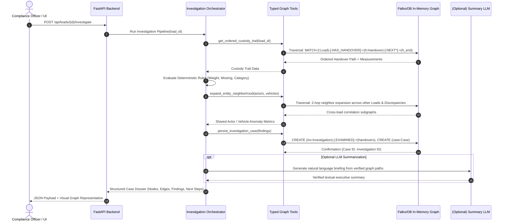

# 05 — Agent Investigation Workflow

> **Notice:** This document specifies the deterministic, graph-driven investigation workflow for ChakraSaakshya. It outlines the sequence of tool operations, graph traversals, LLM boundaries, and data validations that the agent will execute when inspecting a flagged waste custody event.

---

## 1. High-Level Workflow Architecture

The ChakraSaakshya investigation agent is designed to be **deterministic, verifiable, and explainable**. Unlike generative chat agents that hallucinate unstructured answers, this agent performs structured graph traversals via strictly typed graph tools, evaluating mathematical rules and returning auditable path evidence.

---

## 2. Six-Step Deterministic Investigation Sequence

### Step 1: Ingestion & Trigger
- **Input:** Target `load_id` (e.g., `LOAD-2026-0017`).
- **Trigger Source:** API request invoked by a compliance supervisor clicking "Investigate Anomaly" or an automated scheduled audit queue.
- **Validation:** Check that `load_id` exists in FalkorDB. If not found, return `404 Load Not Found` immediately.

### Step 2: Ordered Custody Path Retrieval
- **Graph Dependency:** Queries nodes matching `(l:Load {id: $load_id})-[:HAS_HANDOVER]->(h:Handover)` and traverses temporal edges `-[:NEXT*]->`.
- **Outputs:** An ordered array of Handover records with timestamps, stages, associated `Measurement` nodes, and attached `Evidence` nodes.
- **Failure Handling:** If a load has 0 handovers, flag a fatal schema error. If handovers lack `:NEXT` continuity, identify the broken custody link.

### Step 3: Pairwise Handover Audit & Rule Verification
- **Processing Logic:** 
  - Compare consecutive handover pairs $(H_i, H_{i+1})$.
  - Compute mass deltas using net measurements: $\Delta = H_i.net\_kg - H_{i+1}.net\_kg$.
  - Evaluate against configured tolerances (1.0% relative, 15 kg absolute).
  - Inspect document hashes across `Evidence` nodes to detect reuse.
  - Compare declared waste category strings across stages.
- **Outputs:** List of triggered discrepancy objects with specific numeric deltas and node references.

### Step 4: Network Expansion (Cross-Load Pattern Discovery)
- **Graph Dependency:** Takes the set of `:Actor` and `:Vehicle` nodes connected to the current load. Traverses outwards:
  `MATCH (a:Actor)<-[:FROM|TO]-(other_h:Handover)<-[:HAS_HANDOVER]-(other_l:Load)-[:HAS_DISCREPANCY]->(d:Discrepancy)`
- **Goal:** Determine whether the detected discrepancy is an isolated event or part of a systemic pattern involving shared contractors, drivers, or weighbridges.
- **Outputs:** Correlation statistics: count of concurrent active discrepancies, total aggregate mass loss associated with the entities over the preceding 7-day period.

### Step 5: Persistence of Findings in FalkorDB
- **State Mutability:** Persist the investigation as formal graph entities:
  - Create `:Investigation` node with timestamp, parameters, and outcome verdict.
  - Link `:Investigation` via `:EXAMINED` edges to all inspected `Handover` nodes.
  - Create or update `:Case` node, binding it via `:INVESTIGATES` to the `Load` and `:BASED_ON` to the generated `Discrepancy` nodes.
- **Auditability:** Ensures subsequent supervisors can see who/what investigated the load and exactly which subgraphs were analyzed.

### Step 6: Dossier Synthesis & Inspection Recommendation
- **Return Payload:** Assemble the final response payload containing:
  1. Primary Discrepancy Summary (code, severity, exact mass delta).
  2. Traversed Graph Walk (ordered node IDs and transition timestamps).
  3. Supporting Evidence References (ticket numbers, document URIs, SHA-256 hashes).
  4. Cross-Load Pattern Metrics (correlated loads sharing same actor/vehicle).
  5. Recommended Actionable Inspection Steps for the human officer.

---

## 3. Recommended Inspection Guidance Examples

The agent suggests concrete next steps for human auditors:

| Triggered Rule | Recommended Next Step |
| :--- | :--- |
| `WEIGHT_MISMATCH` | "1. Review weighbridge calibration logs for Station `FAC-TS-01` on 2026-10-15. 2. Inspect vehicle `VEH-TRK-09` tare history for sensor drift. 3. Request physical inspection of driver's route GPS trace between 08:30 and 11:15." |
| `MISSING_HANDOVER` | "1. Contact gate control at `FAC-MRF-02` to verify unrecorded manual paper entry. 2. Check GPS telemetry for vehicle `VEH-TRK-09` to verify route termination location." |
| `DUPLICATE_EVIDENCE` | "1. Review physical weighbridge scale ticket printout #W-9092. 2. Interview weighbridge clerk `ACT-CLK-04` regarding duplicate scan upload." |
| `CATEGORY_CONTRADICTION`| "1. Request visual inspection photo of inbound hopper at MRF reception. 2. Verify whether batch was rejected due to organic contamination." |
| `PATTERN_RISK` | "1. Flag contractor `ACT-CONTR-04` for comprehensive contract compliance audit. 2. Consolidate 4 related open case files into an executive review session." |

---

## 4. LLM Role & Strict Security Guardrails

If an LLM (e.g., via a lightweight API) is integrated into the orchestrator pipeline:
- **Strictly Summarization-Only:** The LLM receives pre-computed, verified graph query results and formats them into a clean executive briefing paragraph.
- **No Unrestricted Cypher Execution:** The LLM is **never** permitted to generate freeform Cypher queries directly against the FalkorDB production instance. All graph traversals are hardcoded in parameterized Python functions.
- **No Hallucination of Evidence:** Every fact in the final briefing must reference an existing node ID returned by the tool calls.
- **No Autonomous Enforcement:** The LLM prompt explicitly restricts the model from writing enforcement verdicts, issuing fines, or declaring criminal guilt.
