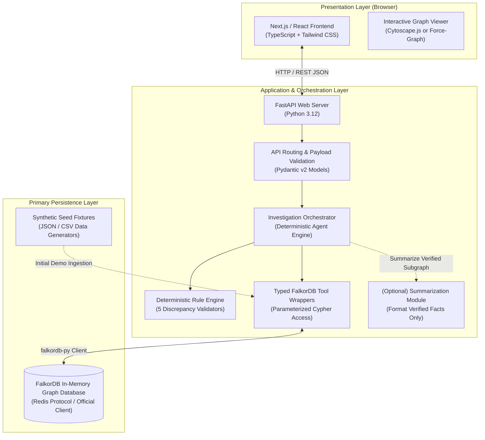

# 06 — System Architecture

> **Notice:** This document defines the conceptual system architecture, software stack, and component communication topology for ChakraSaakshya. It outlines the target design to be implemented during the hackathon. It does not contain executable deployment configurations or running application code.

---

## 1. High-Level System Architecture

The ChakraSaakshya architecture separates presentation, investigation orchestration, and graph data persistence into decoupled layers.

---

## 2. Proposed Technology Stack

| Layer | Proposed Technology | Justification & Role |
| :--- | :--- | :--- |
| **Frontend** | **Next.js / React (v14+)** | Industry-standard developer experience, fast component rendering, and clean state handling for interactive audit screens. |
| **Language & Styling**| **TypeScript + Tailwind CSS** | Strict type safety for API contracts; rapid responsive UI design with clean modern aesthetic. |
| **Graph Visualization**| **Cytoscape.js / React-Force-Graph** | Lightweight in-browser rendering of node-link custody trails and actor neighborhoods. |
| **Backend Framework** | **FastAPI (Python 3.12)** | Asynchronous, high performance, automatic OpenAPI documentation, and native Pydantic schema validation. |
| **Graph Database** | **FalkorDB** | Primary graph database. High-throughput graph traversal, low memory footprint, and standard openCypher dialect compatibility. |
| **DB Client Driver** | **`falkordb` (Official Python Driver)** | Official driver providing connection pooling, query parameterization, and direct graph object mapping. |
| **Local Containerization**| **Docker Compose** | Reproducible development environment running FalkorDB and the backend locally with single-command startup. |

---

## 3. Data Flow Specification

1. **Ingestion & Graph Seeding:**
   - Synthetic JSON/CSV custody records are converted into parameterized Cypher `CREATE` / `MERGE` statements via typed ingestion routines.
   - The graph is fully materialized in FalkorDB with nodes (`Collection`, `Load`, `Handover`, `Measurement`, `Evidence`, `Actor`, `Vehicle`, `Facility`) and directed relationships (`:NEXT`, `:CARRIED_BY`, `:MEASURED_BY`, etc.).
2. **User Request & Dispatch:**
   - A compliance supervisor accesses the dashboard and triggers an audit on a flagged load (e.g., `POST /api/loads/LOAD-2026-0017/investigate`).
   - The FastAPI router validates request parameters using Pydantic and passes the call to the `InvestigationOrchestrator`.
3. **Graph Traversal & Tool Invocation:**
   - The orchestrator invokes bounded, parameterized graph tools (e.g., `get_ordered_custody_trail(load_id)`).
   - The `falkordb` Python driver executes read-only Cypher queries over the in-memory graph.
4. **Rule Execution & Correlation:**
   - The returned path data is passed to the `RuleEngine` to evaluate mass balance, temporal gaps, and hash collisions.
   - For flagged entities, a 2-hop neighborhood query retrieves concurrent load histories to assess pattern risk.
5. **Persistence of Investigation State:**
   - An `:Investigation` node and an associated `:Case` node are written back into FalkorDB, formalizing the audit trail.
6. **Response & Visualization:**
   - FastAPI serializes the verified graph nodes, edges, calculated deltas, and textual briefing into a typed JSON response.
   - The Next.js frontend renders the interactive custody graph alongside the evidence dossier.

---

## 4. FalkorDB as the Primary Persistence Layer

ChakraSaakshya relies on **FalkorDB as the source of truth** for all domain data:
- **Custody DAGs:** Handover chains and batch splits are inherently non-relational directed graphs.
- **Entity Neighborhoods:** Investigating shared actors, vehicles, and facilities across multiple trips is a graph neighborhood expansion problem.
- **Audit Case Records:** Even cases and investigations are stored as graph nodes linked via `:INVESTIGATES` and `:EXAMINED` edges, creating a unified, interconnected knowledge graph.

---

## 5. Security & Isolation Architecture

- **No Public Database Exposure:** FalkorDB runs in an isolated network boundary, accessible only by the FastAPI backend over internal container networking.
- **Strict Query Parameterization:** All Cypher queries utilize parameterized inputs (`$load_id`, `$actor_id`) to eliminate Cypher injection risks.
- **Stateless Agent Operations:** The investigation orchestrator maintains no unpersisted memory; every audit run reads state from FalkorDB and writes its conclusion back to FalkorDB.
