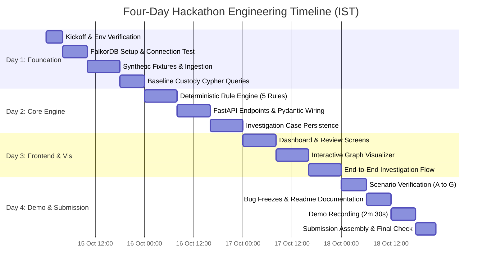

# 09 — Four-Day Build Plan

> **Notice:** This document defines the engineering schedule, milestone gates, acceptance criteria, risk mitigations, and fallback strategies for the hackathon (15–18 October 2026, IST). All execution takes place after official kickoff at 12:01 AM IST on 15 October 2026.

---

## 1. Schedule Overview

---

## 2. Daily Milestone Specifications

### Day 1 (15 October 2026): Graph Database Setup & Data Ingestion
- **Target Goal:** Operational FalkorDB instance with full schema ingested and verified via baseline Cypher queries.
- **Key Tasks:**
  1. Verify official rules, verify FalkorDB client library (`falkordb-py`).
  2. Setup Docker Compose configuration for local FalkorDB and Python 3.12 environment.
  3. Create synthetic fixture generators for Scenarios A through G (JSON/CSV).
  4. Write parameterized Cypher ingestion routines to populate nodes and relationships.
  5. Validate traversal queries (`MATCH (l:Load)-[:HAS_HANDOVER]->(h)-[:NEXT*]->()`).
- **Acceptance Criteria:**
  - `POST /api/demo/reset` successfully populates FalkorDB with all scenario nodes.
  - Query latency for multi-hop path retrieval < 25ms.
- **Risks:** Incompatibility between local Docker and FalkorDB image; openCypher dialect quirks.
- **Fallback Plan:** Fall back to embedded Python graph data structures in memory while troubleshooting FalkorDB container.

---

### Day 2 (16 October 2026): Investigation Engine & Backend API
- **Target Goal:** Deterministic investigation engine running 5 core anomaly rules and persisting review cases in FalkorDB.
- **Key Tasks:**
  1. Implement the 5 investigation rules: `MISSING_HANDOVER`, `WEIGHT_MISMATCH`, `DUPLICATE_EVIDENCE`, `CATEGORY_CONTRADICTION`, `PATTERN_RISK`.
  2. Build investigation orchestrator that coordinates path queries and neighborhood expansion.
  3. Expose REST endpoints: `/api/loads`, `/api/loads/{id}/investigate`, `/api/cases`, `/api/cases/{id}/review`.
  4. Implement `:Investigation` and `:Case` graph persistence.
- **Acceptance Criteria:**
  - Calling `/api/loads/LOAD-2026-0017/investigate` returns correct 250 kg deficit, identifies contractor overlap, and saves `:Case` node to FalkorDB.
- **Risks:** Over-complicating rule logic leads to test flakiness.
- **Fallback Plan:** Focus strictly on `WEIGHT_MISMATCH` and `MISSING_HANDOVER` first; treat `PATTERN_RISK` as secondary extension.

---

### Day 3 (17 October 2026): Interactive Frontend & Visualization
- **Target Goal:** Four connected UI screens allowing a user to browse loads, trigger investigations, explore the custody graph, and submit reviews.
- **Key Tasks:**
  1. Initialize Next.js / Tailwind CSS frontend structure.
  2. Screen 1: Municipal Load Dashboard with status badges and KPI metrics.
  3. Screen 2: Interactive Custody Graph Explorer (Cytoscape or Force-Graph).
  4. Screen 3: Investigation Case Dossier detailing findings and recommended actions.
  5. Screen 4: Supervisor Review & Disposition modal with audit note submission.
- **Acceptance Criteria:**
  - End-to-end user loop: Supervisor selects Load L-017, clicks "Investigate", views graph discrepancy highlighted in red, reads recommendation, and enters review disposition.
- **Risks:** Graph rendering library complexity or layout calculation delays.
- **Fallback Plan:** Use structured SVG or clean tabular timeline layout if interactive canvas library causes integration bottlenecks.

---

### Day 4 (18 October 2026): Hardening, Demo Recording & Submission
- **Target Goal:** Rock-solid local setup, tested scenarios, 2m30s video, and complete hackathon submission.
- **Key Tasks:**
  1. Run end-to-end tests across all 7 scenarios (A through G).
  2. Implement negative test: demonstrate that disabling FalkorDB graph traversals breaks the investigation capability.
  3. Complete comprehensive root `README.md` with architectural diagrams, Cypher queries, and local setup steps.
  4. Record and edit 2m 30s demonstration video adhering strictly to the planned storyboard.
  5. Final submission verification before the 11:59 PM IST cutoff.
- **Acceptance Criteria:**
  - Fresh clone on a clean machine boots with single `docker compose up` command.
  - Video uploaded, repository public, all event submission fields populated.
- **Risks:** Last-minute video encoding delays or submission portal traffic.
- **Fallback Plan:** Freeze code at 6:00 PM IST; dedicate remaining 6 hours exclusively to video, README, and submission.
