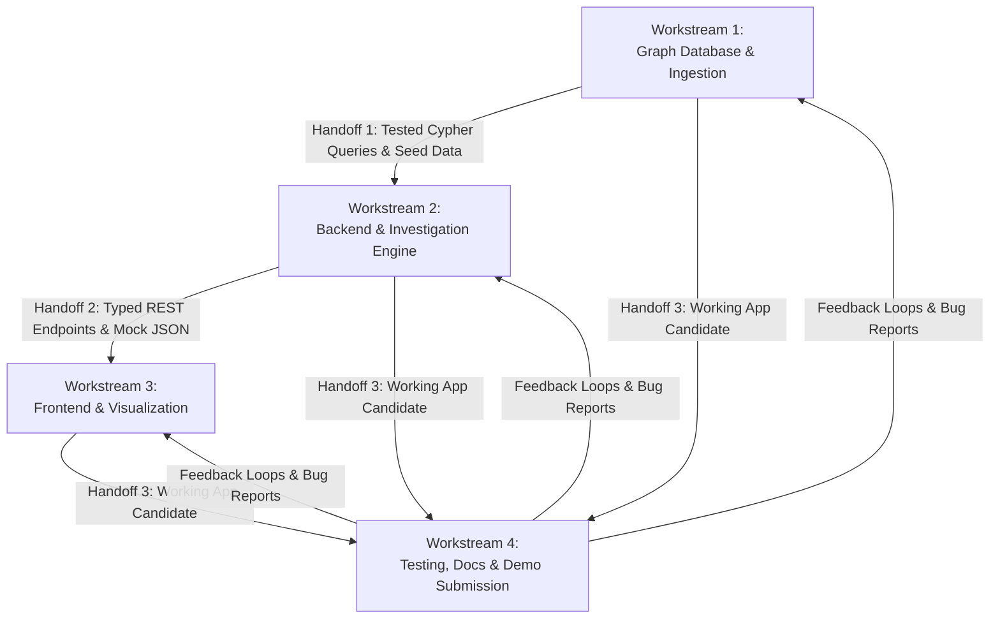

# 10 — Team Task Breakdown

> **Notice:** This document divides the engineering scope into four balanced workstreams for a 4-person team. No team member names or assumed skill levels are assigned here; roles are described by functional responsibility, inputs, outputs, and handoff contracts. The team will assign names during kickoff.

---

## 1. Workstream Matrix

---

## 2. Detailed Workstream Specifications

### Workstream 1: Graph Database & Data Ingestion
- **Focus Area:** FalkorDB setup, schema constraints, parameterized Cypher routines, synthetic data generation.
- **Key Deliverables:**
  - `docker-compose.yml` configuration for FalkorDB container.
  - Python ingestion script converting synthetic JSON manifests into FalkorDB graph nodes and edges.
  - Core parameterized Cypher queries:
    - Path retrieval: `MATCH (l:Load {id: $id})-[:HAS_HANDOVER]->(h)-[:NEXT*]->(end_h)`
    - Neighborhood expansion: `MATCH (a:Actor)<-[:FROM|TO]-(h)<-[:HAS_HANDOVER]-(other_l)`
  - Indexing and uniqueness constraints on node `id` properties.
- **Upstream Dependencies:** Conceptual Graph Schema ([`03-graph-model.md`](file:///c:/Users/manis/OneDrive/Desktop/vit/ChakraSaakshya/planning/03-graph-model.md)).
- **Handoff Contract (to Workstream 2):** Tested Python module `db_client.py` exporting query functions that return typed dictionary payloads of nodes and edges.

---

### Workstream 2: Backend & Investigation Logic
- **Focus Area:** FastAPI web server, Pydantic data models, deterministic rule engine, and case persistence.
- **Key Deliverables:**
  - FastAPI application structure (`main.py`, routers, error handlers).
  - Pydantic models matching the API Contract Plan ([`07-api-contract-plan.md`](file:///c:/Users/manis/OneDrive/Desktop/vit/ChakraSaakshya/planning/07-api-contract-plan.md)).
  - Implementation of the 5 investigation rules:
    - `MISSING_HANDOVER`, `WEIGHT_MISMATCH`, `DUPLICATE_EVIDENCE`, `CATEGORY_CONTRADICTION`, `PATTERN_RISK`.
  - Investigation orchestrator linking tool calls, rule execution, and `:Case` graph persistence.
  - (Optional) Lightweight LLM prompt integration strictly for formatting verified graph findings.
- **Upstream Dependencies:** Workstream 1 database access module.
- **Handoff Contract (to Workstream 3):** Running FastAPI server on `localhost:8000` with interactive Swagger docs at `/docs` returning live mock/seeded data.

---

### Workstream 3: Frontend & Graph Visualization
- **Focus Area:** Next.js application, responsive UI components, interactive graph canvas, and case review flow.
- **Key Deliverables:**
  - Responsive Next.js 14+ app with Tailwind CSS styling.
  - **Screen 1: Municipal Dashboard** — Load list table with search, filter badges, and KPI summary counters.
  - **Screen 2: Interactive Graph View** — Visual custody trail with color-coded nodes (Red = Discrepancy, Green = Verified, Blue = In-Transit).
  - **Screen 3: Case Dossier Panel** — Tabular summary of calculated deltas, ticket references, and actor risk warnings.
  - **Screen 4: Human Review Modal** — Form to submit supervisor notes and resolve open cases.
- **Upstream Dependencies:** Workstream 2 API contracts and mock endpoints.
- **Handoff Contract (to Workstream 4):** Fully integrated browser application running on `localhost:3000` communicating seamlessly with the backend.

---

### Workstream 4: Testing, Integration, Documentation & Submission
- **Focus Area:** End-to-end scenario validation, Docker Compose integration, developer documentation, demo recording, and submission compliance.
- **Key Deliverables:**
  - Validation test harness verifying Scenarios A through G against the live system.
  - Negative proof test: Document and demonstrate that the investigation fails when FalkorDB graph relationships are unavailable.
  - Root `README.md` containing:
    - Architecture diagrams, setup instructions, Cypher query samples, and track declaration.
  - 2-minute 30-second high-definition demo video recording and editing based on the demo script ([`12-demo-and-submission-plan.md`](file:///c:/Users/manis/OneDrive/Desktop/vit/ChakraSaakshya/planning/12-demo-and-submission-plan.md)).
  - Submission portal packet assembly and AI disclosure statement.
- **Upstream Dependencies:** Working builds from Workstreams 1, 2, and 3 by Day 3 evening.

---

## 3. Team Synchronization Rituals

- **Daily Standup (10:00 AM IST):** 15-minute sync on blockers, completed handoffs, and daily goals.
- **Mid-Day Integration Check (03:00 PM IST):** Verify interface alignment between API and frontend.
- **Evening Milestone Review (09:00 PM IST):** Review commits against acceptance criteria, identify risks, and adjust overnight plans.
