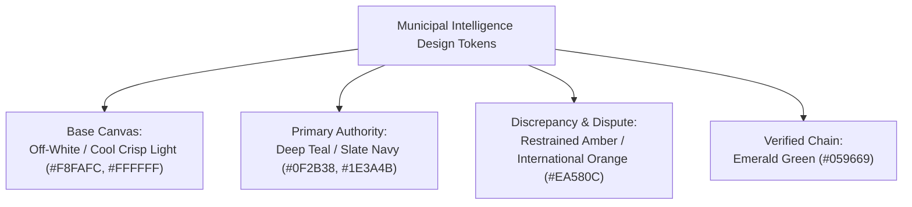
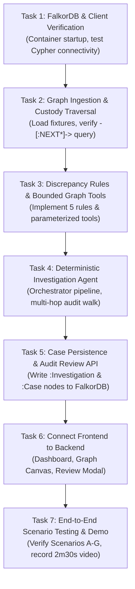

# 15 — Reusable Project Foundation & Readiness Specification

> **Compliance Status: Pre-Event Preparation Only**  
> **Event:** WeMakeDevs × FalkorDB Hackathon — *Graph Hacks: Context for AI Agents* (15–18 October 2026 IST)  
> **Rule Enforcement Notice:** Official rules allow pre-planning, architecture documentation, design specifications, and general library/template identification. However, the core project implementation—specifically the FalkorDB graph schema, ingestion scripts, Cypher queries, discrepancy rules, investigation agent, and project-specific UI screens—**must be created from scratch during the hackathon**.  
> This document establishes the repository layout plan, configuration blueprints, UI visual design tokens, and kickoff dependency tree without implementing any restricted project code.

---

## 1. Planned Repository Layout

The eventual project structure will isolate backend, frontend, local containerization, test scenarios, and documentation as follows:

```text
ChakraSaakshya/
├── PREPARATION.md                     # Pre-hackathon compliance declaration & project index
├── README.md                          # Primary hackathon submission documentation (to build during event)
├── docker-compose.yml                 # Local orchestrator for FalkorDB + Backend + Frontend (at kickoff)
├── .env.example                       # Documented environment variable template (general-purpose)
├── .gitignore                         # Standard git ignore specification (Python, Node, Docker, OS)
│
├── planning/                          # Permitted pre-event planning pack (Files 01 through 15)
│   ├── 01-project-brief.md
│   ├── 02-problem-and-user.md
│   ├── 03-graph-model.md
│   ├── 04-investigation-rules.md
│   ├── 05-agent-workflow.md
│   ├── 06-system-architecture.md
│   ├── 07-api-contract-plan.md
│   ├── 08-test-scenarios.md
│   ├── 09-four-day-build-plan.md
│   ├── 10-team-task-breakdown.md
│   ├── 11-technical-decisions.md
│   ├── 12-demo-and-submission-plan.md
│   ├── 13-kickoff-checklist.md
│   ├── 14-open-questions.md
│   └── 15-project-foundation-spec.md  # (This document)
│
├── backend/                           # Python 3.12 + FastAPI Application (built at kickoff)
│   ├── Dockerfile                     # Standard Python 3.12 slim containerfile
│   ├── pyproject.toml / requirements.txt # Python package manifest
│   ├── app/
│   │   ├── main.py                    # FastAPI entrypoint and router registration
│   │   ├── config.py                  # Pydantic BaseSettings for env management
│   │   ├── models/                    # Pydantic v2 schemas for API contracts
│   │   ├── db/                        # Official FalkorDB client wrappers (built at kickoff)
│   │   ├── rules/                     # 5 Discrepancy rule algorithms (built at kickoff)
│   │   ├── agent/                     # Deterministic investigation orchestrator (built at kickoff)
│   │   └── api/                       # REST endpoint route handlers
│   └── tests/                         # Unit tests & scenario verification scripts
│
├── frontend/                          # Next.js 14+ / React / Tailwind CSS Application (built at kickoff)
│   ├── package.json                   # Standard Next.js dependencies
│   ├── tsconfig.json                  # TypeScript compiler settings
│   ├── tailwind.config.ts             # Tailwind palette & design tokens (configured to palette below)
│   ├── src/
│   │   ├── app/                       # Next.js App Router (layout, page)
│   │   ├── components/                # Reusable UI components (Tables, Badges, Modals)
│   │   │   ├── graph/                 # Cytoscape / Force-graph visualizer component
│   │   │   └── dossier/               # Evidence card and recommendation view
│   │   └── lib/                       # API client and typed interface bindings
│
└── data/                              # Synthetic Test Fixtures (generated at kickoff)
    └── fixtures/                      # JSON / CSV datasets for Scenarios A through G
```

---

## 2. Reusable Infrastructure & Configuration Blueprints

### 2.1 Proposed Environment Variables (`.env.example` Blueprint)
The following environment contract is planned for zero-leakage local execution:

```bash
# ==============================================================================
# ChakraSaakshya - Environment Configuration Blueprint
# Reusable template: No credentials or secrets committed to version control.
# ==============================================================================

# Database Connectivity (FalkorDB)
FALKORDB_HOST=localhost
FALKORDB_PORT=6379
FALKORDB_GRAPH_NAME=chakra_saakshya_custody
FALKORDB_PASSWORD=

# Backend Application Configuration
APP_ENV=development
APP_PORT=8000
APP_DEBUG=true
ALLOWED_CORS_ORIGINS=http://localhost:3000,http://127.0.0.1:3000

# Investigation Engine Parameters (Tolerances)
INVESTIGATION_TOLERANCE_RELATIVE=0.01      # 1.0% mass variance allowance
INVESTIGATION_TOLERANCE_ABSOLUTE_KG=15.0   # 15 kg threshold for scale noise
INVESTIGATION_MAX_TRANSIT_HOURS=6.0        # Max allowable hours before missing receipt flag
INVESTIGATION_ROLLING_WINDOW_DAYS=7        # Rolling window for entity pattern correlation

# Optional LLM Summarizer (Disabled by default, deterministic engine used)
LLM_ENABLED=false
LLM_PROVIDER=none
LLM_API_KEY=
```

### 2.2 Proposed Local Container Topology (`docker-compose.yml` Blueprint)
When implemented at kickoff, the services will link on an internal Docker network:
1. `falkordb`: Image `falkordb/falkordb:latest` exposing port `6379`.
2. `backend`: Python 3.12 FastAPI server running Uvicorn on port `8000`, connected via `FALKORDB_HOST=falkordb`.
3. `frontend`: Node.js Next.js dev server on port `3000`, proxying `/api` requests to `backend:8000`.

---

## 3. UI Visual Direction: Municipal Intelligence Workstation

The visual identity is designed for a focused, high-clarity **Municipal Compliance Intelligence Workstation**:



### Color Palette Tokens
- **Background / Canvas:** Clean, professional off-white/cool slate (`#F8FAFC` base, `#FFFFFF` elevated cards) ensuring readability of complex data tables and legal compliance logs.
- **Primary Authority & Navigation:** Deep Teal / Dark Slate Navy (`#0F2B38` header/nav, `#1E3A4B` structural borders) communicating municipal authority, trust, and analytical rigor.
- **Disputed Evidence & Flags:** Restrained, high-visibility Orange/Amber (`#EA580C` warning badges, `#C2410C` anomaly highlights). Avoids frantic pure-red alarms while unambiguously signaling unverified variance.
- **Verified / Balanced Chain:** Subdued Emerald Green (`#059669` / `#10B981`) for balanced handovers, valid calibration tickets, and closed audit cases.

### Four Core Workstation Screens (Planned for Kickoff Build)
1. **Screen 1 — Overview & Municipal Load Feed:** High-level metrics bar (total tonnage, discrepancy rate, open cases), searchable load inventory with category and status filter badges.
2. **Screen 2 — Interactive Custody Graph Explorer:** Interactive node-link canvas rendering custody stages ($H_1 \to H_2 \to H_3$), vehicles, and actors, highlighting anomalous hops in restrained orange.
3. **Screen 3 — Investigation Workspace & Evidence Dossier:** Side-by-side split screen showing step-by-step traversal trail, weighbridge ticket comparisons, calculated deltas, and cross-load contractor risk metrics.
4. **Screen 4 — Compliance Case Review & Resolution Modal:** Human-in-the-loop review panel where supervisors input official audit dispositions (`JUSTIFIED_LOSS`, `ESCALATED_AUDIT`), document justification reasons, and finalize case status without altering historical records.

---

## 4. Kickoff Implementation Tasks in Dependency Order

When the hackathon officially opens at **12:01 AM IST on 15 October 2026**, the engineering team will execute the following tasks in strict dependency order:



1. **Task 1: Verify FalkorDB and Client Compatibility:** Launch local FalkorDB Docker container; verify Python `falkordb-py` driver connectivity; run baseline Cypher sanity test.
2. **Task 2: Implement Graph Ingestion and Initial Custody Query:** Generate synthetic fixtures (Scenarios A through G); write parameterized Cypher ingestion routines; confirm `-[:NEXT*]->` custody retrieval.
3. **Task 3: Implement Discrepancy Rules and Bounded Graph Tools:** Code mathematical tolerance checks and the 5 anomaly detection rules in Python; build typed graph tool wrappers.
4. **Task 4: Implement Deterministic Investigation Agent:** Wire orchestrator to coordinate ordered custody path retrieval, rule evaluation, and 2-hop entity neighborhood expansion.
5. **Task 5: Persist Investigation Results and Review Cases:** Create graph persistence logic for `:Investigation` and `:Case` nodes in FalkorDB; build human review endpoint `/api/cases/{id}/review`.
6. **Task 6: Connect Frontend to Backend:** Initialize Next.js app with Tailwind color palette; build Overview, Graph Canvas, Dossier, and Review screens; wire to live FastAPI endpoints.
7. **Task 7: Test End-to-End Investigation and Prepare Submission:** Validate all 7 test scenarios; execute negative proof test (disabling FalkorDB); record 2m 30s demonstration video; prepare final public repository submission.
